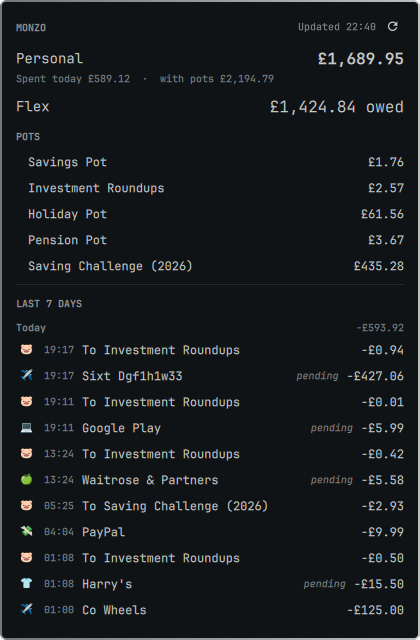

# monzo-omarchy

An [Omarchy 4](https://omarchy.org) bar widget that shows your Monzo
balances, pots and the last 7 days of transactions, using the
[Monzo Developer API](https://docs.monzo.com/).

Click the bank icon in the bar and a panel opens with:

- **Personal account** balance, what you've spent today, and the total including pots
- **Flex**, shown as the amount owed (or "Nothing owed")
- **Pots**, with goals where you've set one
- **Last 7 days** of transactions from both accounts, grouped by day, with a
  `FLEX` tag on Flex purchases and a `pending` marker on unsettled ones

The data refreshes each time you open the panel. Nothing polls in the background.

<p align="center">
  
</p>

> **Personal use only.** Monzo's Developer API is not for public apps: a
> client may only connect to its owner's account or a small set of users
> they explicitly allow. Everyone who uses this widget should create
> **their own** Monzo client (step 2). Never share your client secret.

---

## Requirements

| Need | Notes |
|---|---|
| Omarchy 4 ("Quattro") | The plugin uses the Omarchy shell's built-in UI components. Built against `4.0.0.alpha`; a later shell update could break it. |
| Node.js 22.18+ (or 23.6+) | The CLI is a `.ts` file run directly with Node's built-in type stripping, so there is no build step. It looks for `/usr/bin/node` first, then `node` on your `PATH`. Check with `node --version`. |
| A UK Monzo personal account | Flex is optional; without it there is simply no Flex row. |
| A Nerd Font, `xdg-open` | Both come with Omarchy. |

---

## Setup

### 1. Get the code

```bash
git clone https://github.com/ChromaticRanger/monzo-omarchy.git ~/Projects/monzo-omarchy
cd ~/Projects/monzo-omarchy
```

Any location works; `install.sh` finds the repo wherever it is.

### 2. Create your Monzo OAuth client

1. Go to <https://developers.monzo.com> and sign in with the email
   address on your Monzo account. Monzo emails you a login link; open it,
   then approve the login in the Monzo app.
2. Open **Clients** and choose **New OAuth Client**.
3. Fill in the form:

   | Field | Value |
   |---|---|
   | Name | Anything, e.g. `omarchy-bar` |
   | Logo URL | Leave blank |
   | Redirect URLs | `http://localhost:47821/callback` (see [Choosing a different port](#choosing-a-different-port)) |
   | Description | Anything |
   | Confidentiality | **Confidential** |

   **Confidential matters.** Only confidential clients get a refresh
   token. Without one you would have to log in again every few hours.
4. Save, and keep the page open: you'll need the **Client ID** and
   **Client secret** in step 4.

### 3. Install the widget and CLI

```bash
./install.sh
```

This:

- copies `plugin/` to `~/.config/omarchy/plugins/chromaticranger.monzo/`
- symlinks the CLI to `~/.local/bin/monzo-omarchy`
- asks the Omarchy shell to rescan its plugins and enables the widget

A bank icon (󰁰) should appear on the right of the bar. If it doesn't, see
[Troubleshooting](#troubleshooting).

### 4. Log in to Monzo

```bash
monzo-omarchy login
```

1. Paste your **Client ID**.
2. Paste your **Client secret**. What you type is hidden.
3. Press Enter to accept the default redirect URL, or type the one you
   registered in step 2. It must match **exactly**.
4. Your browser opens on Monzo's login page. Enter your email and open the
   link Monzo sends.
5. The browser shows *"Done. Now approve access in the Monzo app"*. Approve
   the push notification in the Monzo app. The CLI waits up to 5 minutes.
6. The CLI prints your balances, pots and latest transactions. You're done.

### 5. Use it

Click the bank icon. The panel opens and refreshes.

| Action | Key / mouse |
|---|---|
| Open / close | Left-click the icon · `Esc` to close |
| Refresh | `r` in the panel · middle-click the icon · the ⟳ button |
| Scroll | `j` / `k` or arrow keys · mouse wheel |
| Move to the next bar panel | `Tab` / `Shift+Tab` |
| Log in again (when prompted) | `Enter`, or click *Log in* in the panel |

---

## Choosing a different port

The redirect URL does not have to use port 47821. Any free local port works,
as long as the URL registered on your Monzo client and the one you give
`monzo-omarchy login` are identical. For example:

```
http://localhost:51234/monzo
```

Rules for the URL:

- `http://`, not `https://`
- host `localhost` (the CLI listens on `127.0.0.1` and `::1` only)
- an explicit port, ideally above 1024, that nothing else is using
- any path you like

To change it later:

1. Edit the redirect URL on your client at developers.monzo.com.
2. Run `monzo-omarchy login --reconfigure`, and enter your client ID and
   secret again along with the new redirect URL.

---

## Commands

```
monzo-omarchy login [--reconfigure]   log in (asks for client details the first time)
monzo-omarchy refresh                 fetch fresh data (what the panel runs)
monzo-omarchy status                  print the last data fetched
monzo-omarchy debug                   print raw account types, balances and transaction counts
monzo-omarchy logout                  revoke the token and forget it
```

Exit codes: `0` ok, `2` needs login, `1` any other error.

---

## Where things are stored

| File | Contents |
|---|---|
| `~/.config/monzo-omarchy/config.json` | Client ID, client secret, redirect URL |
| `~/.local/state/monzo-omarchy/tokens.json` | Access token and refresh token |
| `~/.local/state/monzo-omarchy/snapshot.json` | The data the panel draws |

All three are created with permissions `600`, readable only by you. The
bar plugin only ever reads `snapshot.json`; credentials never pass through
the shell. `XDG_CONFIG_HOME` and `XDG_STATE_HOME` are honoured if set.

---

## Updating

```bash
cd ~/Projects/monzo-omarchy
git pull
./install.sh
omarchy-restart-shell
```

`omarchy-restart-shell` is needed after any change to the plugin. The
shell notices changed files, but its hot reload reuses the previously
compiled QML, so the old panel stays on screen until the shell restarts.
CLI changes take effect immediately.

---

## Troubleshooting

**`omarchy plugin enable` says the plugin is not known.**
The shell hadn't scanned the new folder yet. Run:
```bash
omarchy-shell shell rescanPlugins && sleep 1 && omarchy plugin enable chromaticranger.monzo
```

**The panel still shows an old version after an update.**
Run `omarchy-restart-shell` (see [Updating](#updating)).

**The panel says "Not logged in to Monzo".**
Press `Enter` in the panel, or run `monzo-omarchy login`. This happens on
first use, after `monzo-omarchy logout`, or if Monzo revokes access.

**Login times out after the browser step.**
- The redirect URL on your Monzo client and in `config.json` must match
  exactly, including the port and path. Fix with
  `monzo-omarchy login --reconfigure`.
- Make sure you approved the notification in the Monzo app.

**"could not listen on port …"**
Another program is using that port. Pick a different one (see
[Choosing a different port](#choosing-a-different-port)).

**"Warning: no refresh token issued"**
Your Monzo client isn't set to Confidential. Edit it, then log in again.

**Something else.** Check the shell log for errors:
```bash
quickshell log -p /usr/share/omarchy/shell 2>&1 | grep -i -B2 -A5 monzo | grep -v IpcHandler | tail -40
```
"Handler was registered but will not be used" lines are normal on
multi-monitor setups (one bar per monitor), and so is "Module path … is
outside of the config folder".

---

## Uninstall

```bash
monzo-omarchy logout                      # revokes the token with Monzo
omarchy plugin disable chromaticranger.monzo
rm -rf ~/.config/omarchy/plugins/chromaticranger.monzo
rm -f  ~/.local/bin/monzo-omarchy
rm -rf ~/.config/monzo-omarchy ~/.local/state/monzo-omarchy
```

You can also delete the client at developers.monzo.com.

---

## How it works

```
 bar icon ──click──▶ Panel.qml ──runs──▶ monzo-omarchy refresh ──HTTPS──▶ api.monzo.com
                        ▲                         │
                        └──watches── snapshot.json ◀┘
```

- `cli/monzo-omarchy.ts` does the OAuth login (with a temporary listener
  on your local machine), token refresh (Monzo refresh tokens can only be
  used once, so each new pair is saved immediately), and API calls. It
  writes everything the panel needs to `snapshot.json`.
- `plugin/Panel.qml` and `plugin/Model.js` render that file using the
  Omarchy shell's own components, so the panel follows your theme and
  keyboard conventions.
- If a refresh fails, the last good data stays on screen with a note
  explaining why.

### Notes on the Monzo API

- Flex reports what you owe as a negative balance; the panel shows it as
  "£X owed".
- Only your first personal (`uk_retail`) and Flex accounts are read.
  Joint, business and rewards accounts are ignored.
- For 5 minutes after a login the API allows full transaction history,
  then only the last 90 days. This widget only ever asks for 7 days.
